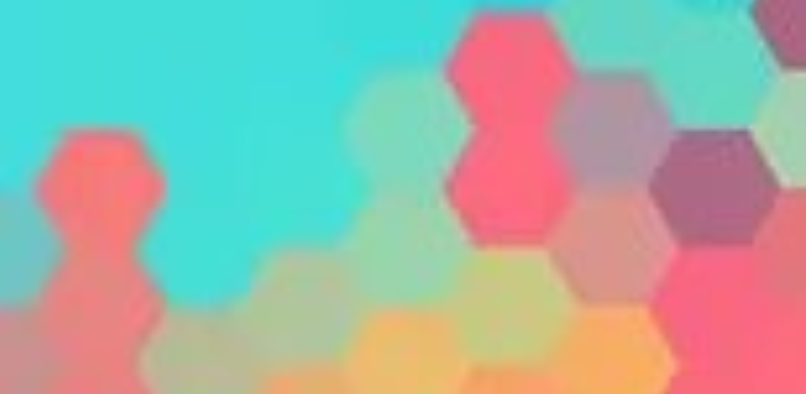
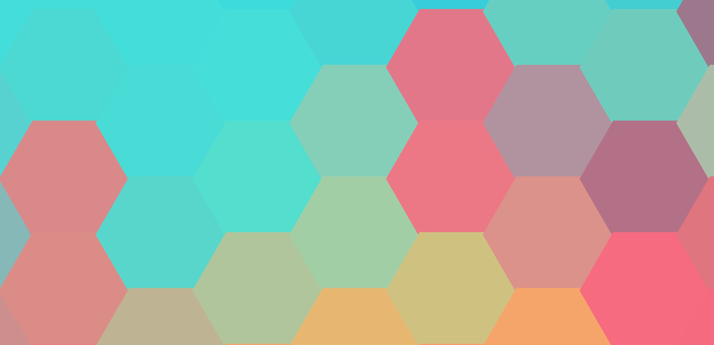

# png2svg

[](https://github.com/Sam84-TECH/png2svg/actions/workflows/tests.yml)

Convert a low-resolution picture made of hexagons into a **scalable SVG**
that stays sharp at any size, ideal for high-resolution wallpapers.

The program reads an image, samples the average color of each hexagon
on a hexagonal grid, and redraws every hexagon as a vector polygon.

## Before / after

Zoomed to the same scale, the original is blurry, the SVG stays sharp.

| Original (bitmap, zoomed) | png2svg output (SVG, zoomed) |
|---------------------------|------------------------------|
|  |  |

Full result: [`docs/example_output.svg`](docs/example_output.svg)

## Installation

Requirement: [uv](https://docs.astral.sh/uv/).

```bash
git clone https://github.com/Sam84-TECH/png2svg.git
cd png2svg
uv sync --all-groups
```

## Usage

### Command line

```bash
uv run png2svg samples/input.jpg output.svg
uv run png2svg samples/input.jpg output.svg --radius 13 --orientation flat
```

| Option | Description | Default |
|--------|-------------|---------|
| `input` | Input image (PNG, JPG, ...) | required |
| `output` | Output SVG file | required |
| `--radius` | Hexagon radius in pixels | `13` |
| `--orientation` | `flat` (flat top) or `pointy` (pointed top) | `flat` |
| `--shape` | `hexagon` or `triangle` (side = `--radius`; `--orientation` applies to hexagons only) | `hexagon` |

Open the SVG in a browser or in Inkscape.

### Python

```python
from png2svg.converter import convert_file

convert_file("samples/input.jpg", "output.svg", radius=13, orientation="flat")
```

### Marimo notebook

```bash
uv run marimo edit notebooks/png2svg_notebook.py
```

Upload an image, choose the radius and the orientation, preview the
result and download the SVG.

## How it works

1. **Load** the image with Pillow and convert it to RGB.
2. **Build the grid**: compute the center of every hexagon covering the image.
   For flat-top hexagons of radius `r`: width `2r`, column spacing `1.5r`,
   vertical spacing `sqrt(3) * r`, every odd column shifted down by `sqrt(3) * r / 2`.
3. **Sample the color**: average the RGB values of all pixels inside a circle
   of radius `r` around each center.
4. **Draw**: create one SVG `<polygon>` per hexagon with the average color.
5. **Write** the SVG file.

The matching hexagon orientation matters: using pointed-top hexagons on a
flat-top image rotates every cell by 30 degrees and blends the colors.

## Development

```bash
uv run pytest --cov=src --cov-report=term-missing   # tests + coverage (>= 90%)
uv run ruff format .                                # formatting
uv run ruff check .                                 # linting
uv run mypy src                                     # type checking
```

## Project structure

```
png2svg/
├── .github/workflows/tests.yml   # CI: format, lint, types, tests + coverage
├── docs/                         # images used in this README
├── notebooks/png2svg_notebook.py # Marimo notebook
├── samples/input.jpg             # sample input image
├── src/png2svg/
│   ├── geometry.py               # hexagon vertices and grid centers
│   ├── imaging.py                # image loading and color sampling
│   ├── svg.py                    # SVG generation
│   ├── converter.py              # full conversion pipeline
│   └── cli.py                    # command-line interface
├── tests/                        # unit tests for each module
└── pyproject.toml
```

## Git workflow

- Every feature is declared as a GitHub issue
- One branch per feature, merged through a Pull Request (`Closes #N`)
- Test-driven development: failing test, implementation, refactoring
- [Conventional Commits](https://www.conventionalcommits.org/) (`feat:`, `test:`, `ci:`, `docs:`)
- CI must be green before merging into `main`

## Author

KOUYELE Samaa Ashley, Refresher in Computer Science 2026-2027
